<div align="center">

<p>
  
  &nbsp;&nbsp;&nbsp;&nbsp;
  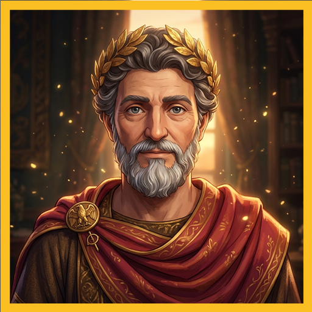
</p>

# Greatest Minds & Smarter Than a 7-Year-Old IQ

**Multi-Variant Cross-Platform Mobile Studio — Powering Two Standalone Production Apps from One Modular Expo + TypeScript Codebase**

[](https://github.com/Wakjira7/greatest-minds-smarter7yo/actions/workflows/ci.yml)
%20%7C%20iOS%20%7C%20Web-3DDC84?logo=android&logoColor=white)


-F59E0B)
[](https://play.google.com/store/apps/details?id=com.wakjira.smarter7yo)

<p>
  <a href="#-app-1--smarter-than-a-7-year-old-iq-comwakjirasmarter7yo">Smarter Than a 7-Year-Old IQ</a> •
  <a href="#-app-2--greatest-minds-stoic-ai-chat-comwakjiragreatestminds">Greatest Minds: Stoic AI Chat</a> •
  <a href="#-multi-variant-build-architecture">Architecture</a> •
  <a href="#-9-language-global-localization">9-Language i18n</a> •
  <a href="#%EF%B8%8F-getting-started">Getting Started</a>
</p>

</div>

---

## 📖 Overview

Engineered by **Wakjira Shewangzaw Dabi**, this repository implements a **compile-time multi-variant Expo SDK 52 architecture** ([`app.config.js`](app.config.js) + [`eas.json`](eas.json)) capable of compiling two distinct, store-compliant mobile applications—each with its own Android application ID, iOS bundle identifier, adaptive icon, splash theme, and feature lock—while sharing a unified Material Design 3 theme engine, local persistence layer, localization framework, and monetization state machine:

| Standalone App | Package / Bundle ID | Category & Core Engine |
| :--- | :--- | :--- |
| **[Smarter Than a 7-Year-Old IQ](https://play.google.com/store/apps/details?id=com.wakjira.smarter7yo)** | `com.wakjira.smarter7yo` | **100% Offline Grade-School Trivia & IQ Ladder** with 5 prodigy classmates, 3 lifelines, report cards, and 9-language support |
| **Greatest Minds: Stoic AI Chat** | `com.wakjira.greatestminds` | **200 3D Historical & Stoic AI Mentors** across 10 Mastery Realms, Mind Odyssey Path, Supabase + Gemini Edge Function, and offline Socratic mode |

> 💡 **Companion App Repository**: Looking for App #3 in the portfolio (**OmniScan: Offline PDF OCR Pro** — `com.wakjira.offlineocr`)? Visit **[`Wakjira7/omniscan-offline-ocr`](https://github.com/Wakjira7/omniscan-offline-ocr)**.

---

## 🎓 App #1 — Smarter Than a 7-Year-Old IQ (`com.wakjira.smarter7yo`)

<div align="center">
  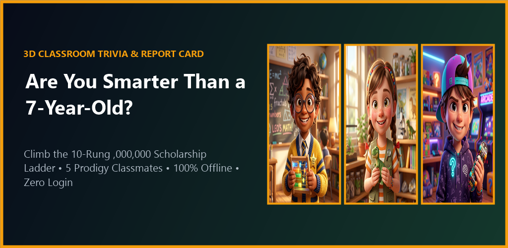
</div>

<br />

<div align="center">
<table>
  <tr>
    <td align="center">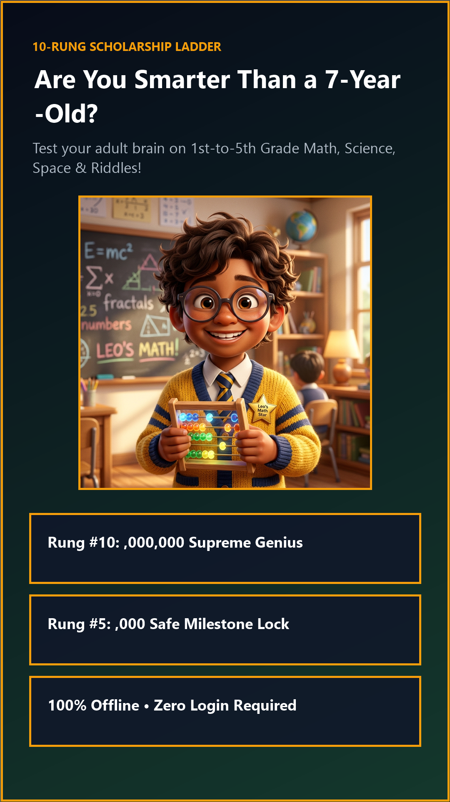<br /><sub><b>1. Question-First Trivia Arena</b></sub></td>
    <td align="center">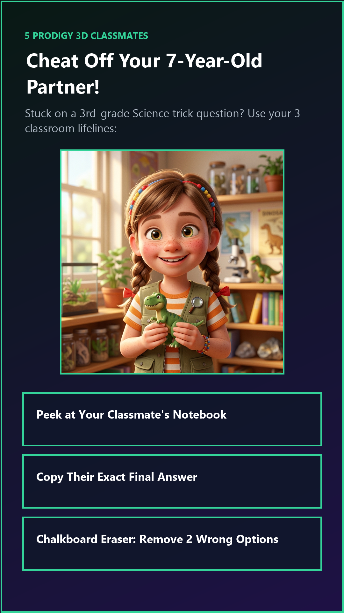<br /><sub><b>2. Classmates & 3 Lifelines</b></sub></td>
    <td align="center">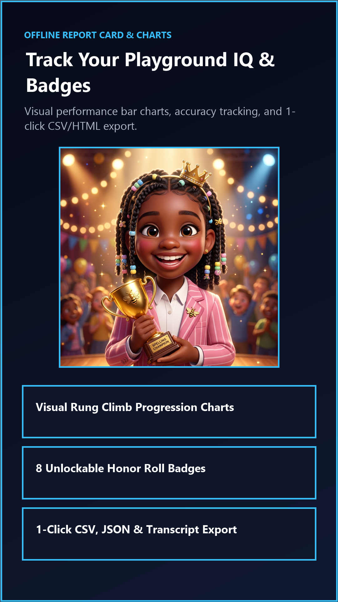<br /><sub><b>3. Persistent Report Card</b></sub></td>
    <td align="center">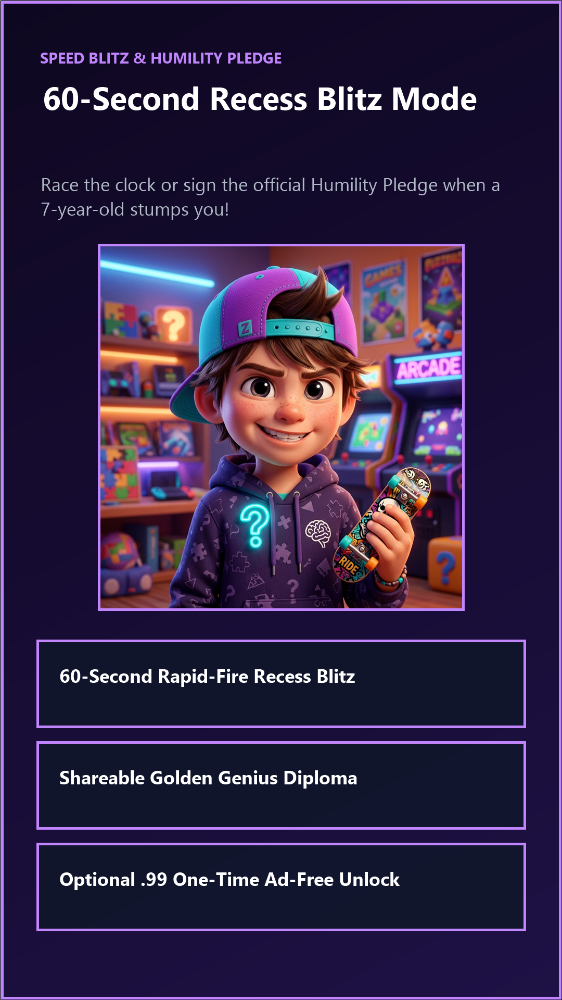<br /><sub><b>4. Badges & Transcript Export</b></sub></td>
  </tr>
</table>
</div>

### Key Features (`SmarterThan7YoApp.tsx`)
- **Above-the-Fold Question-First UX**: Opens directly into the active trivia challenge, 4 answer choices, and lifelines with zero login walls or loading spinners.
- **5 Specialized Classmate Partners & 3 Lifelines**: Partner with **Leo** (Math), **Maya** (Science), **Toby** (Space), **Chloe** (Spelling), and **Zane** (Logic Riddles), using *Peek*, *Copy*, and *Erase-2* lifelines across the 10-rung Scholarship Ladder.
- **Frame-1 Multi-Language Welcome Picker**: Instantaneous switching across **9 languages** (`English`, `አማርኛ Amharic`, `Deutsch`, `Soomaali`, `العربية Arabic`, `Español`, `Français`, `Português`, `日本語 Japanese`).
- **100% Offline Analytics & Export**: Tracks subject accuracy, best streaks, rung progression charts, and 8 unlockable badges in `AsyncStorage`, with 1-tap CSV/JSON/Transcript export.

---

## 🏛️ App #2 — Greatest Minds: Stoic AI Chat (`com.wakjira.greatestminds`)

<div align="center">
  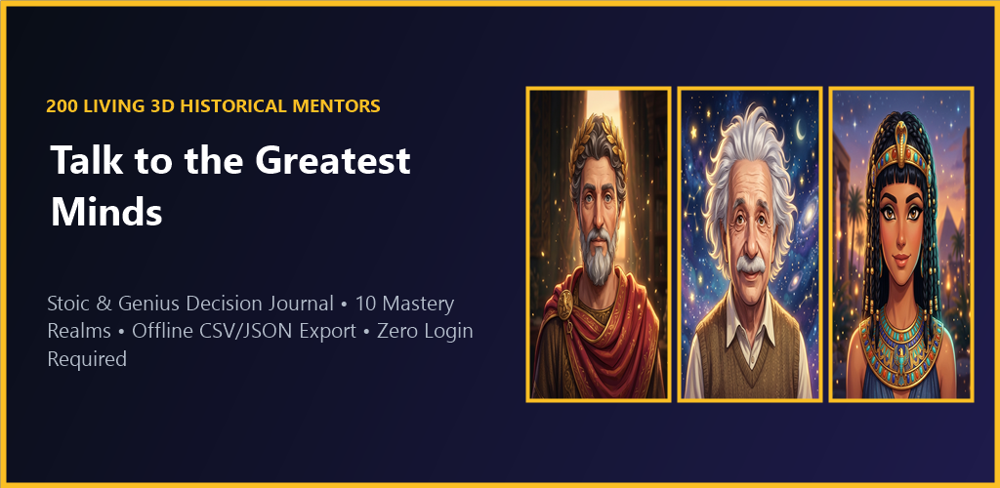
</div>

<br />

<div align="center">
<table>
  <tr>
    <td align="center">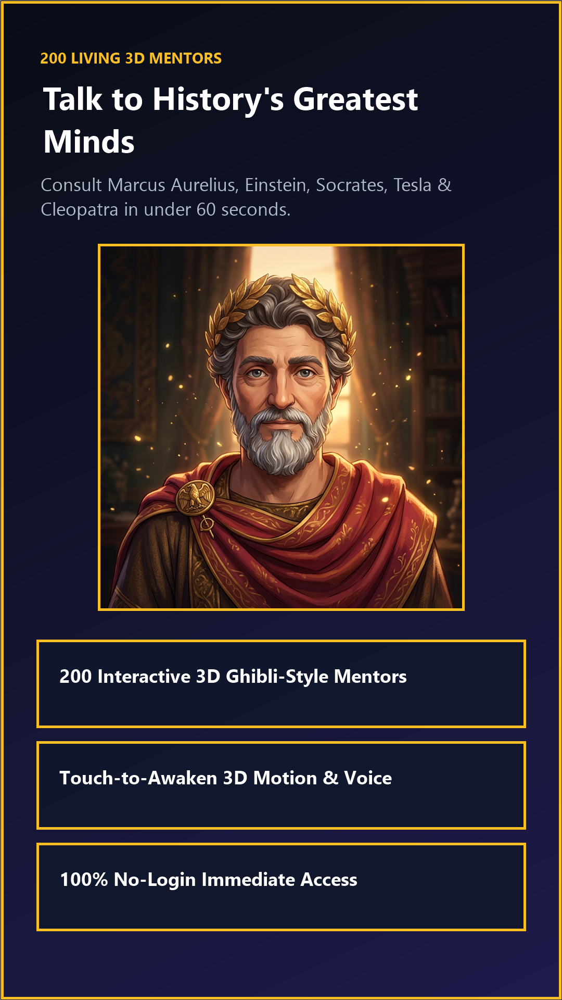<br /><sub><b>1. 200 3D Historical Mentors</b></sub></td>
    <td align="center">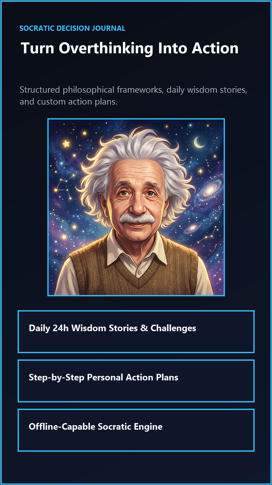<br /><sub><b>2. Socratic Action Chat & TTS</b></sub></td>
    <td align="center">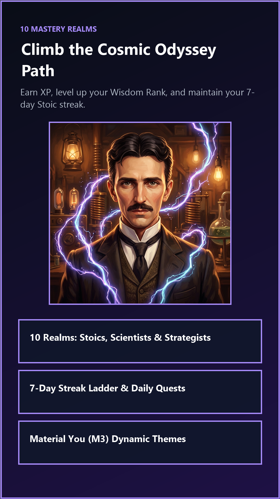<br /><sub><b>3. 10-Realm Mind Odyssey Path</b></sub></td>
    <td align="center">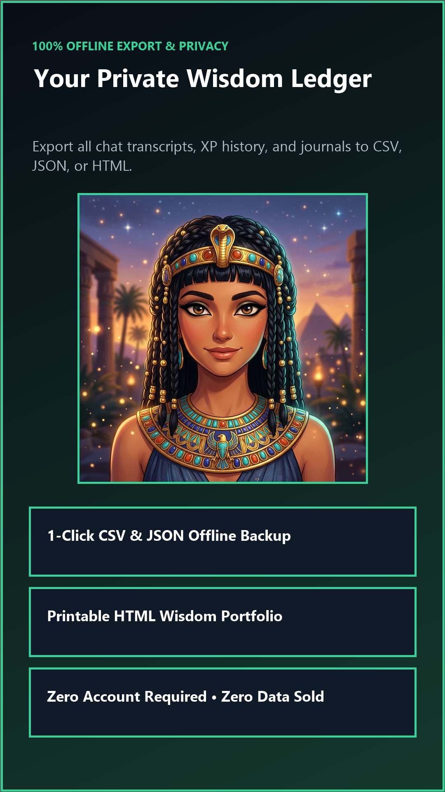<br /><sub><b>4. Offline Journal & Export</b></sub></td>
  </tr>
</table>
</div>

### Key Features (`greatestMinds200.ts`, `Persona3DCarousel.tsx`, `MindOdysseyPath.tsx`)
- **200 Interactive 3D Personas Across 10 Mastery Realms**: Consult Marcus Aurelius, Socrates, Albert Einstein, Nikola Tesla, Queen Cleopatra VII, Sun Tzu, and 194 additional historical thinkers and parody coaches—rendered with animated 3D portrait physics and `expo-speech` voice read-aloud.
- **Dual-Mode AI Inference (Serverless Gemini + Instant Offline Socratic Fallback)**:
  - **Live Cloud Mode**: Routes through a secure Deno **Supabase Edge Function** ([`supabase/functions/persona-chat/index.ts`](supabase/functions/persona-chat/index.ts)) keeping `GEMINI_API_KEY` strictly server-side with sliding-window context trimming (`8` messages, `<180` words) for predictable token economics.
  - **Offline Socratic Mode**: Runs out-of-the-box with zero API keys required using deterministic in-character Socratic reasoning frameworks.
- **Google Play 2026 Generative AI Policy Compliance**: Built-in AI Parody Disclaimer Banner ([`DisclaimerBanner.tsx`](src/components/DisclaimerBanner.tsx)) and per-message **"Report AI Message"** moderation flow ([`ReportModal.tsx`](src/components/ReportModal.tsx)).
- **Material Design 3 Live Theme Bar**: Instant runtime switching across 5 curated Material You palettes (*Gold Dark*, *Dynamic Violet*, *Ghibli Forest*, *Cyber Ocean*, *Daylight Cream*).

---

## 🧩 Multi-Variant Build Architecture

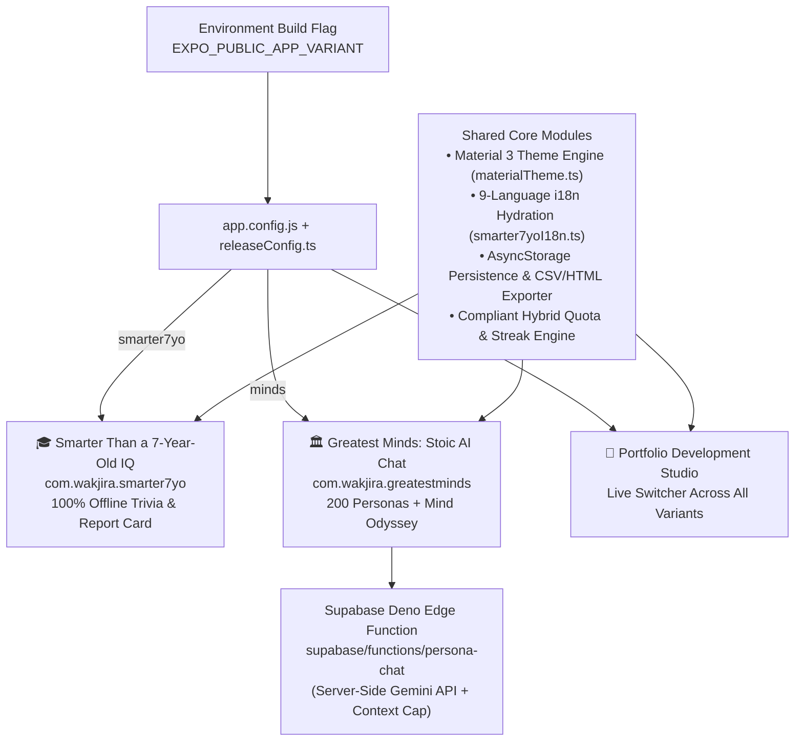

👉 Deep-dive documentation: **[`docs/ARCHITECTURE.md`](docs/ARCHITECTURE.md)** • **[`docs/LOCALIZATION.md`](docs/LOCALIZATION.md)** • **[`docs/DEPLOYMENT.md`](docs/DEPLOYMENT.md)**

---

## 🌍 9-Language Global Localization

UI strings, onboarding screens, categories, and gameplay flows are localized with priority global & East African / European markets first:

| Code | Language | Script / Direction |
| :--- | :--- | :--- |
| `en` | English | Latin (`LTR`) |
| `am` | Amharic (`አማርኛ`) | Ge'ez Ethiopic (`LTR`) |
| `de` | German (`Deutsch`) | Latin (`LTR`) |
| `so` | Somali (`Soomaali`) | Latin (`LTR`) |
| `ar` | Arabic (`العربية`) | Arabic (`RTL`) |
| `es` | Spanish (`Español`) | Latin (`LTR`) |
| `fr` | French (`Français`) | Latin (`LTR`) |
| `pt` | Portuguese (`Português`) | Latin (`LTR`) |
| `ja` | Japanese (`日本語`) | Kanji / Kana (`LTR`) |

---

## 📁 Project Structure

```text
greatest-minds-smarter7yo/
├── .github/
│   ├── workflows/ci.yml              # Strict TypeScript check & credential hygiene gate
│   ├── ISSUE_TEMPLATE/               # Bug report & feature request templates
│   └── PULL_REQUEST_TEMPLATE.md
├── app/                              # Expo Router v4 file-based navigation
│   ├── _layout.tsx                   # SafeAreaProvider & stack transitions
│   ├── index.tsx                     # Variant-aware root screen & M3 theme shell
│   ├── smarter.tsx                   # Dedicated trivia route
│   └── chat/[id].tsx                 # Dynamic per-persona AI chat screen
├── assets/
│   ├── personas/                     # Custom 3D historical & classmate portraits
│   ├── playstore/                    # Official Play Store icons, banners & screenshots
│   └── sounds/                       # Offline audio feedback effects
├── docs/
│   ├── ARCHITECTURE.md               # Multi-variant config, AI edge proxy & state design
│   ├── LOCALIZATION.md               # 9-language Frame-1 hydration & RTL guide
│   └── DEPLOYMENT.md                 # EAS Build profiles & Android 16 release checklist
├── src/
│   ├── components/                   # SmarterThan7YoApp, Persona3DCarousel, MindOdysseyPath...
│   ├── constants/                    # greatestMinds200, smarter7yoData, smarter7yoI18n, M3 themes
│   ├── services/                     # chatService, storage, smarterProgress, monetization, export
│   └── types/                        # Strict TypeScript domain interfaces
├── supabase/
│   └── functions/persona-chat/       # Deno Edge Function securing server-side Gemini keys
├── .env.example                      # Safe client env template (runs offline when blank)
├── app.config.js                     # Dynamic multi-app Expo configuration (API 36)
├── eas.json                          # Variant-specific APK & Play Store AAB build profiles
└── package.json
```

---

## ⚙️ Getting Started

### 1. Clone & Install

```bash
git clone https://github.com/Wakjira7/greatest-minds-smarter7yo.git
cd greatest-minds-smarter7yo

npm install --legacy-peer-deps
npm run typecheck
```

### 2. Run Any App Variant Locally

No API keys are required—both apps work **100% offline out of the box**:

```bash
# Launch interactive Portfolio Studio in Web / Expo Go
npx expo start --web

# Launch locked to "Smarter Than a 7-Year-Old IQ"
EXPO_PUBLIC_APP_VARIANT=smarter7yo npx expo start --web

# Launch locked to "Greatest Minds: Stoic AI Chat"
EXPO_PUBLIC_APP_VARIANT=minds npx expo start --web
```

### 3. Optional: Connect Live Gemini via Supabase Edge Function

```bash
cp .env.example .env
npx supabase login
npx supabase secrets set GEMINI_API_KEY="your-key" GEMINI_MODEL="gemini-2.5-flash"
npx supabase functions deploy persona-chat --no-verify-jwt
```

---

## 📚 Documentation

- **[Multi-Variant & Edge AI Architecture](docs/ARCHITECTURE.md)**
- **[9-Language Frame-1 Localization System](docs/LOCALIZATION.md)**
- **[EAS Cloud Build & Android 16 Deployment](docs/DEPLOYMENT.md)**
- **[Privacy & Generative AI Safety Policy](PRIVACY.md)**
- **[Security & Credential Isolation Policy](SECURITY.md)**
- **[Release Changelog](CHANGELOG.md)**
- **[Contributing Guidelines](CONTRIBUTING.md)**

---

## 📄 License & Intellectual Property

Copyright © 2026 **Wakjira Shewangzaw Dabi** (`wakjira7@gmail.com`). All Rights Reserved.

Published as a **source-available engineering portfolio** protected under German Copyright Law (*Urheberrechtsgesetz — UrhG*) and international copyright treaties. Viewing and auditing for educational, academic, and technical recruitment evaluation is welcomed; commercial redistribution or repackaging is prohibited without written permission. See [`LICENSE`](LICENSE) and [`TERMS_AND_COPYRIGHT.md`](TERMS_AND_COPYRIGHT.md).
