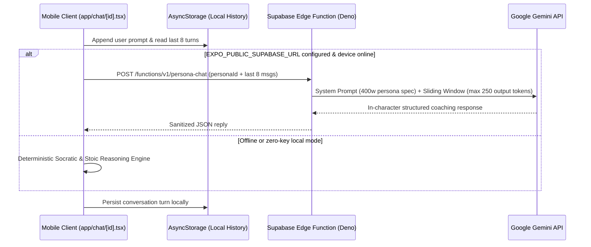

# System Architecture — Multi-Variant Studio & Edge AI Proxy

This document explains how a single modular **Expo SDK 52 + TypeScript** codebase compiles two distinct Google Play Store applications (**`com.wakjira.smarter7yo`** and **`com.wakjira.greatestminds`**) with zero runtime bloat or developer-dashboard leakage in production.

---

## 1. Compile-Time Variant Isolation (`app.config.js` & `releaseConfig.ts`)

Rather than maintaining duplicated repositories that drift out of sync on SDK upgrades, `app.config.js` reads `EXPO_PUBLIC_APP_VARIANT` and `EXPO_PUBLIC_RELEASE_MODE` during Metro/EAS bundling:

| Build Profile (`eas.json`) | `EXPO_PUBLIC_APP_VARIANT` | `android.package` | Behavior at Runtime |
| :--- | :--- | :--- | :--- |
| `production-smarter7yo` | `smarter7yo` | `com.wakjira.smarter7yo` | Locks root screen to `SmarterThan7YoApp`, strips internal studio controls (`IS_STORE_PRODUCTION_BUILD = true`). |
| `production-minds` | `minds` | `com.wakjira.greatestminds` | Locks root screen to `Greatest Minds` 200-persona advisor, hides internal cost/strategy modals. |
| Local `expo start` | `dual` (default) | Dev Client / Web | Enables live variant switcher & Material Design 3 theme studio for rapid QA. |

---

## 2. Greatest Minds: Dual-Mode Inference Pipeline

### Key Design Choices
1. **Zero Client-Side Secret Exposure**: `GEMINI_API_KEY` lives exclusively inside Supabase Edge Function secrets (`Deno.env.get('GEMINI_API_KEY')`). Even if an APK/AAB is decompiled, no LLM credentials exist in the client bundle.
2. **Bounded Token Economics**: `supabase/functions/persona-chat/index.ts` truncates chat history to the most recent `8` messages and enforces a `250`-token output ceiling (`<180` words), guaranteeing predictable per-turn latency and cost.
3. **100% Offline Availability**: When offline or run by a reviewer/recruiter without `.env` keys, `chatService.ts` seamlessly activates character-authentic Socratic frameworks for all 200 personas.

---

## 3. Smarter Than a 7-Year-Old IQ: Synchronous Frame-1 State Engine

- **Zero-Spinner First Paint**: Progress, rung streaks, lifelines, and language selection initialize synchronously on Frame 1 before hydrating persisted state from `AsyncStorage`, preventing blank splash hangs on low-end Android devices.
- **Core Action Above the Fold**: The active question card, 4 answer choices, and 3 classmate lifelines occupy the top viewport immediately; secondary classmate bios (`Leo`, `Maya`, `Toby`, `Chloe`, `Zane`) remain compact and expand on tap.

---

## 4. Material Design 3 (`MATERIAL_3_PRESETS`) Tonal System

[`src/constants/materialTheme.ts`](../src/constants/materialTheme.ts) implements Google's Material You tonal surface hierarchy (`background`, `surfaceContainerLow` $\rightarrow$ `surfaceContainerHighest`, `primaryContainer`, `onSurfaceVariant`) across five switchable palettes (`m3_gold_dark`, `m3_violet_dark`, `m3_emerald_dark`, `m3_ocean_dark`, `m3_ghibli_light`), ensuring WCAG-compliant contrast in both dark and daylight environments.
